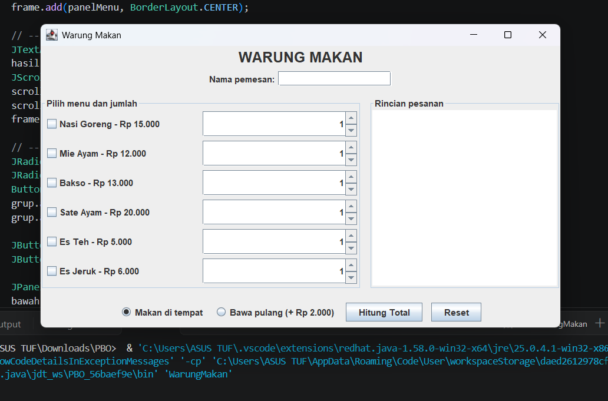
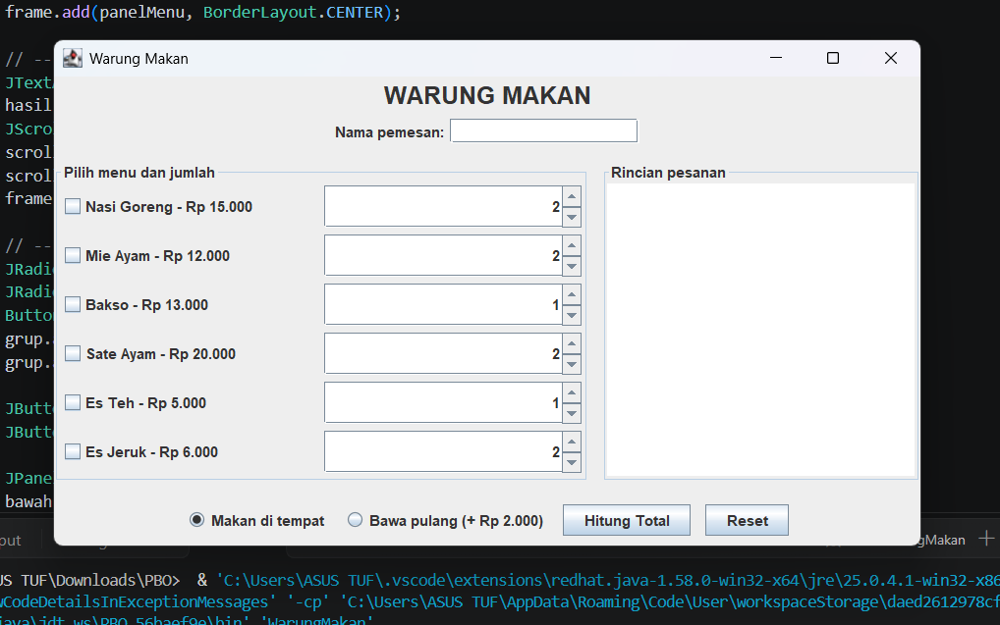
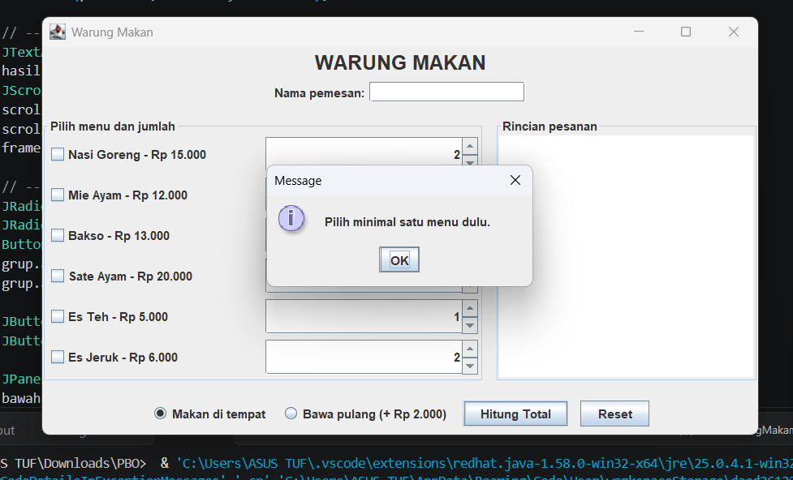

# tugaspbo
# Aplikasi Warung Makan (Java Swing)

Aplikasi desktop sederhana berbasis **Java Swing** untuk mencatat pesanan di sebuah warung makan. Pengguna dapat memilih menu, menentukan jumlah porsi, memilih jenis pesanan (makan di tempat atau bawa pulang), lalu melihat rincian dan total pembayaran.

## Identitas

| | |
|---|---|
| **Nama** | *Sigit Dezan Zulpi* |
| **NIM** | *F1D02510134* |
| **Kelas / Mata Kuliah** | *PBO* |

## Fitur

- Input **nama pemesan**.
- Pilih menu dengan **checkbox** dan atur jumlah dengan **spinner** (1–50).
- Pilihan jenis pesanan dengan **radio button**:
  - *Makan di tempat*
  - *Bawa pulang* (dikenakan biaya kemasan Rp 2.000)
- Tombol **Hitung Total** untuk menampilkan rincian pesanan dan total harga.
- Tombol **Reset** untuk mengosongkan semua isian.
- Validasi: muncul pesan peringatan jika belum ada menu yang dipilih.
- Format harga dalam rupiah, contoh `Rp 15.000`.

## Daftar Menu

| No | Menu | Harga |
|---|---|---|
| 1 | Nasi Goreng | Rp 15.000 |
| 2 | Mie Ayam | Rp 12.000 |
| 3 | Bakso | Rp 13.000 |
| 4 | Sate Ayam | Rp 20.000 |
| 5 | Es Teh | Rp 5.000 |
| 6 | Es Jeruk | Rp 6.000 |

> Menu dan harga disimpan dalam array `menu[]` dan `harga[]` di awal program. Jumlah isi kedua array harus sama jika ingin menambah atau mengubah menu.

## Komponen yang Digunakan

| Komponen | Kegunaan |
|---|---|
| `JFrame` | Jendela utama aplikasi |
| `JLabel` | Judul dan label teks |
| `JTextField` | Input nama pemesan |
| `JCheckBox` | Memilih menu |
| `JSpinner` | Menentukan jumlah porsi |
| `JRadioButton` + `ButtonGroup` | Memilih jenis pesanan |
| `JButton` | Tombol Hitung Total dan Reset |
| `JTextArea` + `JScrollPane` | Menampilkan rincian pesanan |
| `JOptionPane` | Dialog peringatan |
| `BorderLayout`, `GridLayout`, `FlowLayout` | Pengaturan tata letak |

## Cara Menjalankan

**Prasyarat:** JDK 8 atau lebih baru sudah terpasang.

1. Simpan file `WarungMakan.java` pada sebuah folder.
2. Buka terminal / command prompt di folder tersebut.
3. Kompilasi program:
   ```bash
   javac WarungMakan.java
   ```
4. Jalankan program:
   ```bash
   java WarungMakan
   ```

## Cara Penggunaan

1. Isi **nama pemesan**.
2. Centang menu yang diinginkan, lalu atur jumlahnya.
3. Pilih **Makan di tempat** atau **Bawa pulang**.
4. Klik **Hitung Total** untuk melihat rincian pesanan.
5. Klik **Reset** untuk memulai pesanan baru.

## Cara Kerja Singkat

- Saat **Hitung Total** ditekan, program mengulang seluruh menu dan memproses yang dicentang: `subtotal = jumlah × harga`.
- Semua subtotal dijumlahkan menjadi total. Jika dipilih *Bawa pulang*, biaya kemasan ditambahkan satu kali.
- Jika tidak ada menu yang dicentang, program menampilkan dialog "Pilih minimal satu menu dulu."
- Method `rupiah(int angka)` menyisipkan titik pemisah ribuan agar angka mudah dibaca.

## Tampilan Program (Screenshot)

> Letakkan file gambar di folder `screenshots/` lalu sesuaikan nama file di bawah ini.

### 1. Tampilan Awal


### 2. Pesanan Makan 


### 3. Hasil


## Struktur Folder

```
.
├── WarungMakan.java
├── README.md
└── screenshots/
    ├── 01-tampilan-awal.png
    ├── 02-makan-di-tempat.png
    ├── 03-bawa-pulang.png
    ├── 04-peringatan.png
    └── 05-reset.png
```
